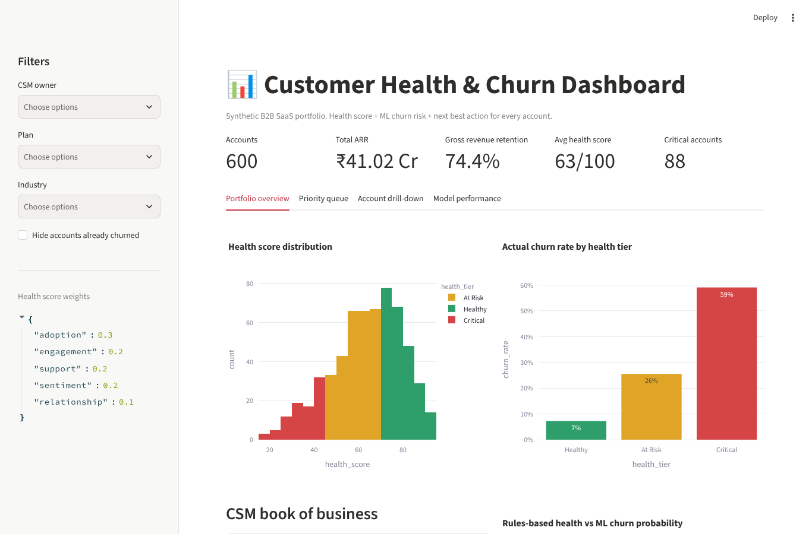

# Customer Health Score & Churn Prediction

An end-to-end Customer Success analytics project: it scores every account's health, predicts which customers are likely to churn, and produces a prioritised **"accounts to work this week"** list with a recommended next action for the CSM.

Built to mirror how a real CS team works: a transparent health score the account owner can explain, an ML model to catch risk the rules miss, SQL KPIs leadership asks for (GRR, NPS, churn by segment), and an interactive dashboard.

   

---

## The business problem

A CSM managing 100+ accounts can't review every account every week. They need answers to three questions:

1. **Which accounts are unhealthy, and why?**
2. **Which of those are most likely to churn, and how much revenue is at stake?**
3. **What should I do about it this week?**

This project answers all three.

## What it does

| Step | Module | Output |
|---|---|---|
| Generate a realistic synthetic SaaS customer base (600 accounts, 6 months of usage) | `churn/generate_data.py` | `data/accounts.csv`, `data/monthly_usage.csv` |
| Build account-level features: seat adoption, usage trend, logins per user, tickets, escalations, NPS, days since last CSM touch, time to onboard, renewal timing | `churn/features.py` | one row per account |
| **Health score (0-100)**: weighted, explainable score across 5 areas | `churn/health_score.py` | score, tier (Healthy / At Risk / Critical), weakest area |
| **Churn model**: Logistic Regression vs Random Forest, 5-fold CV, best model kept | `churn/model.py` | `models/churn_model.joblib`, `models/metrics.json` |
| **CSM playbook**: next best action per account, urgent flag for near-term renewals | `churn/playbook.py` | `data/csm_priority_queue.csv` |
| **SQL KPIs**: GRR, churn by plan, CSM book of business, onboarding speed vs churn, NPS, adoption trend | `sql/kpi_queries.sql`, `churn/db.py` | SQLite database + query results |
| **Dashboard** with filters by CSM, plan and industry | `app.py` | Streamlit web app |

### Health score design

| Component | Weight | Signal |
|---|---|---|
| Adoption | 30% | Active users ÷ purchased seats |
| Engagement | 20% | Is usage growing or shrinking over the last 3 months? |
| Support | 20% | Ticket volume and escalations |
| Sentiment | 20% | Latest NPS response |
| Relationship | 10% | Days since last CSM contact |

Tiers: **Healthy** ≥ 70 · **At Risk** 45-69 · **Critical** < 45

## Results (on the included synthetic dataset)

**The health score separates churners clearly:**

| Tier | Accounts | Actual churn rate |
|---|---|---|
| Healthy | 237 | 7.2% |
| At Risk | 275 | 25.5% |
| Critical | 88 | 59.1% |

**Churn model:** Logistic Regression selected (CV ROC-AUC 0.80 vs 0.79 for Random Forest); hold-out ROC-AUC 0.71, PR-AUC 0.53 against a 23% base churn rate.
Top churn drivers (permutation importance): logins per user, seat adoption, number of features used, days since last CSM touch.

**SQL insights:**
- Accounts onboarded in ≤ 3 weeks churned at **12%**, vs **41%** for those that took more than 5 weeks, a strong case for investing in onboarding speed.
- Gross revenue retention: 74.4%; NPS: -24.

> All data is synthetic and generated by `generate_data.py`. No real customer information is used.

## Quick start

```bash
git clone https://github.com/Kowshikhvarma/customer-health-churn-analytics.git
cd customer-health-churn-analytics
python -m venv .venv && source .venv/bin/activate      # Windows: .venv\Scripts\activate
pip install -r requirements.txt

export PYTHONPATH=src                                   # Windows (PowerShell): $env:PYTHONPATH="src"
python -m churn.pipeline      # train model, score accounts, build priority queue
python -m churn.db            # load SQLite DB and print every SQL KPI
streamlit run app.py          # open the dashboard at http://localhost:8501
pytest                        # run the test suite
```

## Dashboard



- **Portfolio overview**: health distribution, churn by tier, CSM book of business, health vs churn-probability scatter
- **Priority queue**: accounts sorted by ARR at risk, with next best action and CSV export
- **Account drill-down**: health component radar chart, monthly usage and ticket trend
- **Model performance**: ROC-AUC, PR-AUC and feature importance

## Project structure

```
customer-health-churn-analytics/
├── app.py                  # Streamlit dashboard
├── src/churn/
│   ├── generate_data.py    # synthetic SaaS customer data
│   ├── features.py         # feature engineering
│   ├── health_score.py     # explainable health score
│   ├── model.py            # churn model training & evaluation
│   ├── playbook.py         # next-best-action recommendations
│   ├── db.py               # SQLite loader + SQL runner
│   └── pipeline.py         # end-to-end run
├── sql/
│   ├── schema.sql
│   └── kpi_queries.sql
├── data/                   # generated CSVs
├── models/                 # metrics.json (model file is git-ignored)
└── tests/
```

## Tech stack

Python · pandas · NumPy · scikit-learn · SQL (SQLite, PostgreSQL-compatible) · Streamlit · Plotly · pytest

## Author

**Kowshikh Varma Balerao**, Customer Success Manager · [LinkedIn](https://www.linkedin.com/) · kowshikhvarma@gmail.com
